# Guía 9 : Medir latencia de periféricos

## Objetivo

En esta guía se espera que el lector pueda medir la latencia de sus periféricos de forma precisa, diferenciando entre la latencia proporcionada por los drivers que manejan estos periféricos y el de su funcionamiento interno.

## Contexto

Tradicionalmente, un periférico diseñado en un nivel de abstracción bajo, como Verilog (o generado mediante HLS), puede caracterizarse a nivel de ciclo de reloj de manera relativamente sencilla, por ejemplo, mediante un testbench. Sin embargo, al integrarlo en un sistema de mayor nivel de abstracción, como uno basado en un procesador, la comunicación entre ambos módulos introduce un costo temporal adicional. Este costo es aún más notorio en sistemas que incluyen un sistema operativo, caso que no se abordará por el momento.

Como se vio en guías previas, el System ILA permite observar la comunicación en el bus de interconexión. En este caso, se utilizará para realizar mediciones de forma simultánea con la ejecución de la aplicación.

###  ¿Como interactúa el procesador con las escrituras/lecturas ?

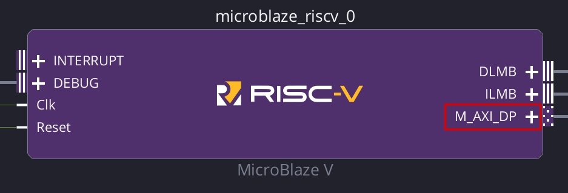{ #fig_M_AXI_DP width="1000" }

El procesador se conecta al bus de interconexión a través de la interfaz de datos de periféricos (M_AXI_DP) vista en la , fijándonos en el manual del procesador se tiene que:

> **Peripheral Interfaces**  
> The MicroBlaze V AXI4 memory mapped peripheral interfaces are implemented as 32-bit masters. Each of these interfaces only have a single outstanding transaction at any time, and all transactions are completed in order.
>
> The instruction peripheral interface (`M_AXI_IP`) only performs single word read accesses, and is always set to use the AXI4-Lite subset.
>
> The data peripheral interface (`M_AXI_DP`) performs single word accesses, and is set to use the AXI4-Lite subset as default, but is set to use AXI4 when enabling exclusive access for `lr` and `sc` instructions. Halfword and byte writes are performed by setting the appropriate byte strobes. Each write transaction waits for `M_AXI_DP_BVALID` before the store instruction is completed.

Al momento que el procesador decide realizar una escritura/lectura, espera hasta el momento en el bus de interconexión confirma que esta se realizó con exito.

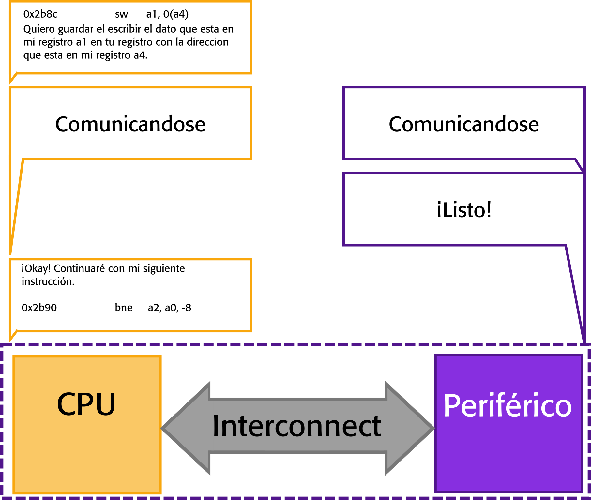{ #fig_M_AXI_DP width="1000" }

## Diseño de Hardware

### Agregar IPs al repositorio

Para esta guía se disponen de 2 dos módulos,ambos son Adder trees, uno diseñado en verilog como se mostró en la guía X  y uno diseñado con el flujo HLS como en la guía X. Ambos poseen 256 entradas de 8 bits.

Descarguelos y agregue las IPs a su repositorio, para esto vaya a Tools>Settings y en la ventana emergente como se ve en la .

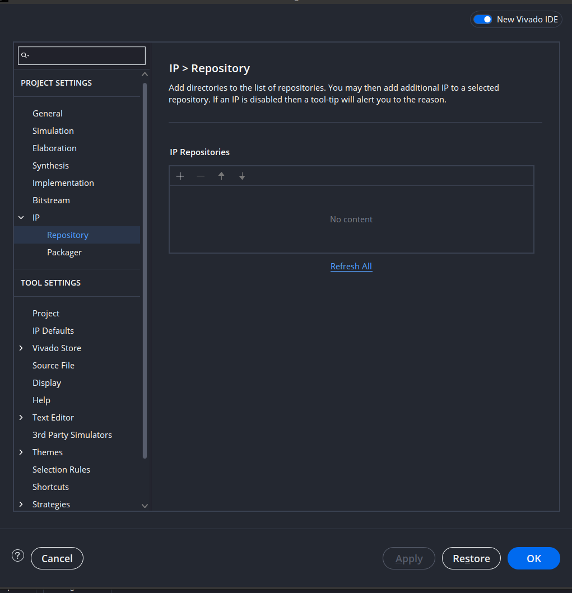{ #fig_IP_repo width="700" }

Busque las carpetas, que contienen las IPs, debería verse como en la .

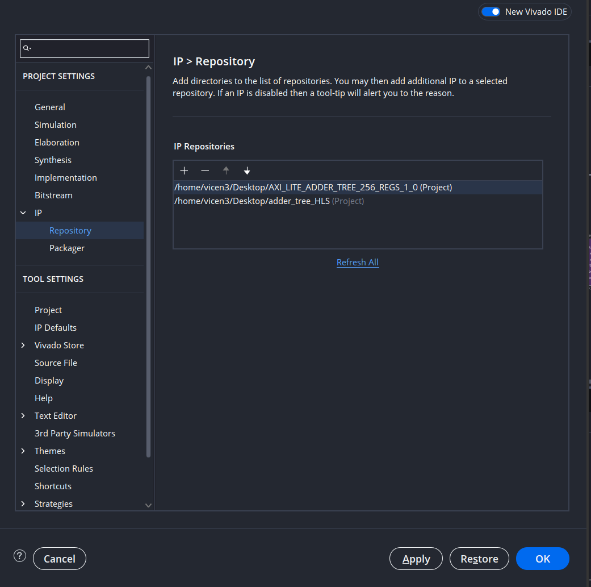{ #fig_IP_repo_withIP width="700" }

### Diagrama de bloques 

Importe el MicroBlaze V al diagrama de bloques con 128kb de memoria y el controlador de interrupciones, note que en esta guía **NO** se hará uso de memoria externa, debido a que su úso añade varios ciclos de reloj a cada instrucción.

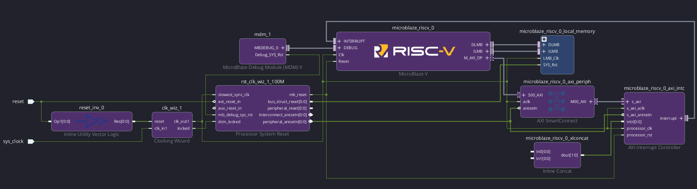{ #fig_SistemaBase width="1500" }

Luego agregue los IPs importados y corra *Run Connection Automation*, debería verse similar a .

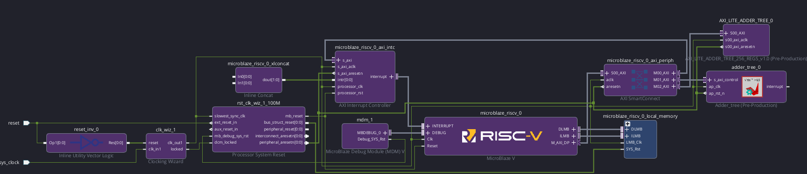{ #fig_IP_enBD width="1500" }

Para poder mesurar el tiempo y reportar resultados obtenidos, agregue las IPs *AXI Timer* y *AXI Uartlite*. Luego corra   *Run Connection Automation* ,debería verse similar a .

**OPCIONAL** : Puede cambiar la configuración de *AXI Uartlite* en este punto haciendo doble click para cambiar el baudrate entre otras configuraciones (note que el baudrate solo se puede cambiar desde la perspectiva de diseño de hardware).

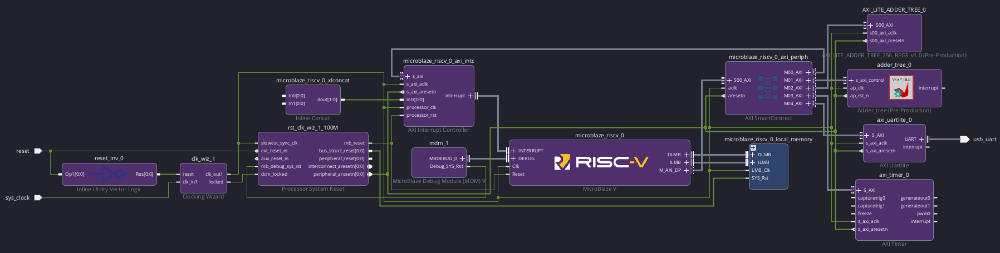{ #fig_timer width="1500" }

Luego realice las siguientes conexiones para habilitar interrupciones en los periféricos relevantes:

- Axi Uartlite > interrupt -> In[0]> In line Concat
- Axi Timer > interrupt -> In[1]> In line Concat

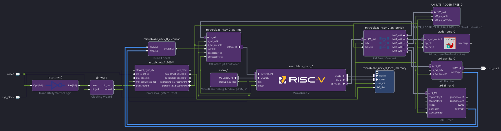{ #fig_irq width="1500" }

Finalmente importe la IP que nos ayudara a analizar el comportamiento dinámico; System ILA 

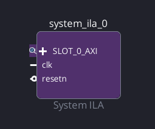{ #fig_irq width="500" }

Haga doble click sobre la IP para configurarla, en este caso hará uso de 4 canales y 4 comparadores como se ve en la .

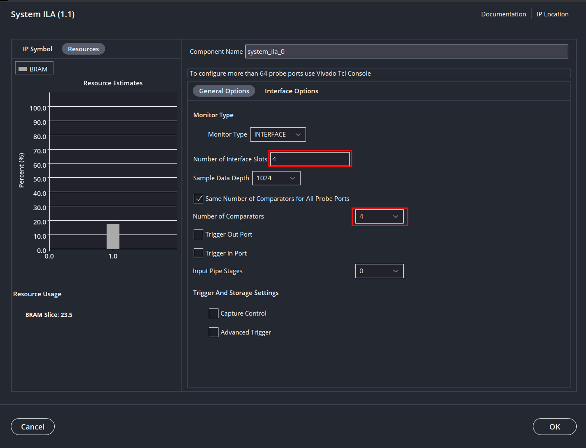{ #fig_ilaConfig width="1000" }

Debido a que este es un módulo particularmente complejo, no posee la funcionalidad de *Run Connection Automation* por lo que hay que realizar manualmente las siguientes conexiones.

- System ILA > SLOT_0_AXI -> M_AXI_DP > MicroBlaze V
- System ILA > SLOT_1_AXI -> S_AXI > AXI Timer 
- System ILA > SLOT_2_AXI -> S00_AXI > AXI_LITE_ADDER_TREE_256_REGS 
- System ILA > SLOT_3_AXI -> s_axi_control > Adder_tree
- System ILA > clk -> clk_out1 > Clocking Wizard 
- System ILA > resetn -> peripheral_aresetn >  Processor System Reset

Una vez realizadas todas las conexiones, se deberia ver como en la 

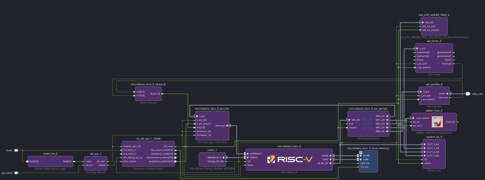{ #fig_BD_Final width="1500" }

Tras verificar que el diseño esta correctamente diseñado a nivel de interconexiones, genere la envoltura de hdl, corra síntesis, implementacion y exporte el hardware.

Agregar repo de sw...

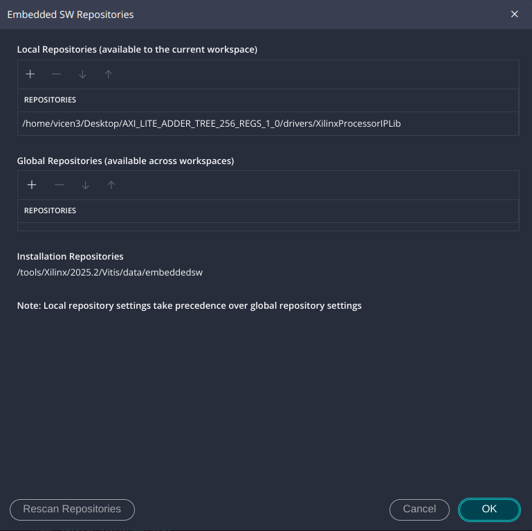{ #fig_Software_repo width="1500" }

Generar plataforma 

Ver drivers

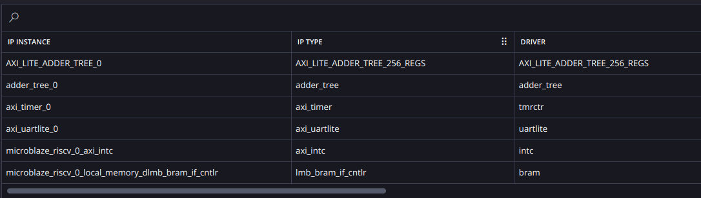{ #fig_Software_repo width="1500" }

Generar aplicación

## Diseño de Firmware

### Análisis de driver de periférico diseñado en Verilog

### Análisis de driver de periférico diseñado en HLS

## Validación
