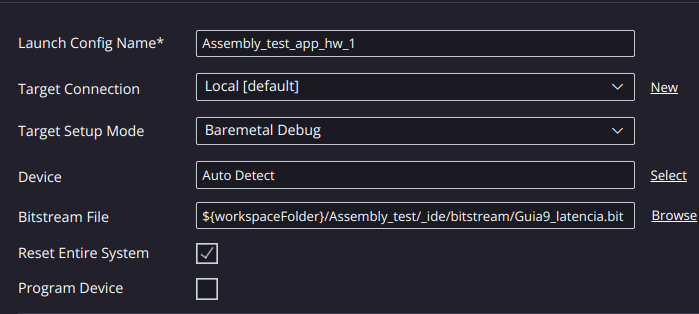
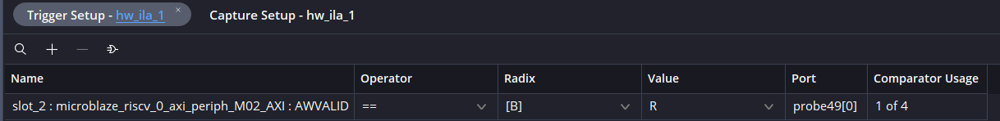
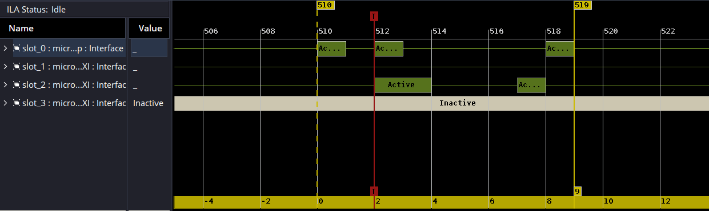
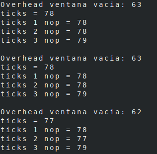

# Guía 9 : Medir latencia de periféricos


## Objetivo

En esta guía se espera que el lector pueda medir la latencia de sus periféricos de forma precisa, diferenciando entre la latencia proporcionada por los drivers que manejan estos periféricos y el de su funcionamiento interno.


## Contexto

Tradicionalmente, un periférico diseñado en un nivel de abstracción bajo, como Verilog (o generado mediante HLS), puede caracterizarse a nivel de ciclo de reloj de manera relativamente sencilla, por ejemplo, mediante un testbench. Sin embargo, al integrarlo en un sistema de mayor nivel de abstracción, como uno basado en un procesador, la comunicación entre ambos módulos introduce un costo temporal adicional. Este costo es aún más notorio en sistemas que incluyen un sistema operativo, caso que no se abordará por el momento.

Como se vio en guías previas, el System ILA permite observar la comunicación en el bus de interconexión. En este caso, se utilizará para realizar mediciones de forma simultánea con la ejecución de la aplicación.


###  ¿Como interactúa el procesador con las escrituras/lecturas ?


{ #fig_M_AXI_DP width="1000" }

El procesador se conecta al bus de interconexión a través de la interfaz de datos de periféricos (M_AXI_DP) vista en la [](#fig_M_AXI_DP), fijándonos en el manual del procesador se tiene que:

> **Peripheral Interfaces**  
> The MicroBlaze V AXI4 memory mapped peripheral interfaces are implemented as 32-bit masters. Each of these interfaces only have a single outstanding transaction at any time, and all transactions are completed in order.
>
> The instruction peripheral interface (`M_AXI_IP`) only performs single word read accesses, and is always set to use the AXI4-Lite subset.
>
> The data peripheral interface (`M_AXI_DP`) performs single word accesses, and is set to use the AXI4-Lite subset as default, but is set to use AXI4 when enabling exclusive access for `lr` and `sc` instructions. Halfword and byte writes are performed by setting the appropriate byte strobes. Each write transaction waits for `M_AXI_DP_BVALID` before the store instruction is completed.


Al momento que el procesador decide realizar una escritura/lectura, espera hasta el momento en el bus de interconexión confirma que esta se realizó con exito.

{ #fig_M_AXI_DP width="1000" }

## Diseño de Hardware


### Agregar IPs al repositorio

Para esta guía se disponen de 2 dos módulos,ambos son Adder trees, uno diseñado en verilog como se mostró en la guía X  y uno diseñado con el flujo HLS como en la guía X. Ambos poseen 256 entradas de 8 bits.


Descarguelos y agregue las IPs a su repositorio, para esto vaya a Tools>Settings y en la ventana emergente como se ve en la [](#fig_IP_repo).

{ #fig_IP_repo width="700" }

Busque las carpetas, que contienen las IPs, debería verse como en la [](#fig_IP_repo_withIP).

{ #fig_IP_repo_withIP width="700" }

### Diagrama de bloques 

Importe el MicroBlaze V al diagrama de bloques con 128kb de memoria y el controlador de interrupciones, note que en esta guía **NO** se hará uso de memoria externa, debido a que su úso añade varios ciclos de reloj a cada instrucción.


{ #fig_SistemaBase width="1500" }

Luego agregue los IPs importados y corra *Run Connection Automation*, debería verse similar a [](#fig_IP_enBD).

{ #fig_IP_enBD width="1500" }

Para poder mesurar el tiempo y reportar resultados obtenidos, agregue las IPs *AXI Timer* y *AXI Uartlite*. Luego corra   *Run Connection Automation* ,debería verse similar a [](#fig_timer).

**OPCIONAL** : Puede cambiar la configuración de *AXI Uartlite* en este punto haciendo doble click para cambiar el baudrate entre otras configuraciones (note que el baudrate solo se puede cambiar desde la perspectiva de diseño de hardware).

{ #fig_timer width="1500" }

Luego realice las siguientes conexiones para habilitar interrupciones en los periféricos relevantes:

- Axi Uartlite > interrupt -> In[0]> In line Concat
- Axi Timer > interrupt -> In[1]> In line Concat

{ #fig_irq width="1500" }

Finalmente importe la IP que nos ayudara a analizar el comportamiento dinámico; System ILA []()


{ #fig_irq width="500" }

Haga doble click sobre la IP para configurarla, en este caso hará uso de 4 canales y 4 comparadores como se ve en la [](#fig_ilaConfig).

{ #fig_ilaConfig width="1000" }


Debido a que este es un módulo particularmente complejo, no posee la funcionalidad de *Run Connection Automation* por lo que hay que realizar manualmente las siguientes conexiones.


- System ILA > SLOT_0_AXI -> M_AXI_DP > MicroBlaze V
- System ILA > SLOT_1_AXI -> S_AXI > AXI Timer 
- System ILA > SLOT_2_AXI -> S00_AXI > AXI_LITE_ADDER_TREE_256_REGS 
- System ILA > SLOT_3_AXI -> s_axi_control > Adder_tree
- System ILA > clk -> clk_out1 > Clocking Wizard 
- System ILA > resetn -> peripheral_aresetn >  Processor System Reset

Una vez realizadas todas las conexiones, se deberia ver como en la [](#fig_BD_Final)

{ #fig_BD_Final width="1500" }

Tras verificar que el diseño esta correctamente diseñado a nivel de interconexiones, genere la envoltura de hdl, corra síntesis, implementacion y exporte el hardware.

Una vez exportado el hardware, **NO CIERRE VIVADO**  y abra Vitis.

Una vez en vitis, agregue la carpeta donde se guardan los drivers a los repositorios de software como se vio en guias anteriores.


{ #fig_Software_repo width="1500" }

Genere el componente de plataforma, deberia poder visualizar los periféricos en la perspectiva de BSP.

{ #fig_Software_repo width="1500" }

Finalmente genere el componente de aplicación.


## Diseño de Firmware

Debido a la complejidad de este ejemplo, se hara uso de 3 componentes de aplicación, con 2 siendo asignados al analisis de los drivers de los perfiericos, mientras que el primer ejemplo esta dedicado a entender como la latencia de la comunicación afecta al uso efectivo del periférico por parte del procesador.

### Ejemplo mínimo escritura

Importe el ejemplo Test_assembly.c a su proyecto:
```c
#include "xil_printf.h"
#include "xtmrctr.h"


XTmrCtr     TimerInstance;

#define TIMER_COUNTER_0   0
#define TIMER_COUNTER_1   1

int main(void)
{
    u32 ticks;
    int Status;

    Status = XTmrCtr_Initialize(&TimerInstance, XPAR_AXI_TIMER_0_BASEADDR);
    if (Status != XST_SUCCESS) return XST_FAILURE;

    /* ================================================================ */
    /*  Overhead de medición.                                           */
    /* ================================================================ */

    XTmrCtr_Reset(&TimerInstance, TIMER_COUNTER_0);
    XTmrCtr_Start(&TimerInstance, TIMER_COUNTER_0);
    XTmrCtr_Stop(&TimerInstance, TIMER_COUNTER_0);
    ticks = XTmrCtr_GetValue(&TimerInstance, TIMER_COUNTER_0);

    xil_printf("Overhead ventana vacia: %d\r\n", ticks);


    /* ================================================================ */
    /*  Medición de escritura en un periferico                          */
    /* ================================================================ */


    u32 value = 1; 
    u32 addr  = XPAR_AXI_LITE_ADDER_TREE_0_BASEADDR;

    XTmrCtr_Reset(&TimerInstance, TIMER_COUNTER_0);
    XTmrCtr_Start(&TimerInstance, TIMER_COUNTER_0);
    __asm__ volatile (
        "sw %0, 0(%1)"            
        :                         
        : "r"(value), "r"(addr)   
        : "memory"
    );
    XTmrCtr_Stop(&TimerInstance, TIMER_COUNTER_0);
    ticks = XTmrCtr_GetValue(&TimerInstance, TIMER_COUNTER_0);
    xil_printf("ticks = %d\r\n", ticks);

    /* ================================================================ */
    /*  Medición de escritura en un periferico con 1 NOP                */
    /* ================================================================ */


     value = 1;  
     addr  = XPAR_AXI_LITE_ADDER_TREE_0_BASEADDR;

    XTmrCtr_Reset(&TimerInstance, TIMER_COUNTER_0);
    XTmrCtr_Start(&TimerInstance, TIMER_COUNTER_0);
    __asm__ volatile(
    "nop\n\t"
    "sw %0, 0(%1)\n\t"
    :
    : "r"(value), "r"(addr)
    : "memory");
    XTmrCtr_Stop(&TimerInstance, TIMER_COUNTER_0);
    ticks = XTmrCtr_GetValue(&TimerInstance, TIMER_COUNTER_0);
    xil_printf("ticks 1 nop = %d\r\n", ticks);

    /* ================================================================ */
    /*  Medición de escritura en un periferico con 2 NOP                */
    /* ================================================================ */


     value = 1;  
     addr  = XPAR_AXI_LITE_ADDER_TREE_0_BASEADDR;

    XTmrCtr_Reset(&TimerInstance, TIMER_COUNTER_0);
    XTmrCtr_Start(&TimerInstance, TIMER_COUNTER_0);
    __asm__ volatile(
    "nop\n\t"
    "nop\n\t"
    "sw %0, 0(%1)\n\t"
    :
    : "r"(value), "r"(addr)
    : "memory");
    XTmrCtr_Stop(&TimerInstance, TIMER_COUNTER_0);
    ticks = XTmrCtr_GetValue(&TimerInstance, TIMER_COUNTER_0);
    xil_printf("ticks 2 nop = %d\r\n", ticks);


    /* ================================================================ */
    /*  Medición de escritura en un periferico con 3 NOP                */
    /* ================================================================ */


     value = 1;  
     addr  = XPAR_AXI_LITE_ADDER_TREE_0_BASEADDR;

    XTmrCtr_Reset(&TimerInstance, TIMER_COUNTER_0);
    XTmrCtr_Start(&TimerInstance, TIMER_COUNTER_0);
    __asm__ volatile(
    "nop\n\t"
    "nop\n\t"
    "nop\n\t"
    "sw %0, 0(%1)\n\t"
    :
    : "r"(value), "r"(addr)
    : "memory");
    XTmrCtr_Stop(&TimerInstance, TIMER_COUNTER_0);
    ticks = XTmrCtr_GetValue(&TimerInstance, TIMER_COUNTER_0);
    xil_printf("ticks 3 nop = %d\r\n", ticks);
    xil_printf("\r\n");
   
    return 0;
}
```
Este codigo tiene el proposito de contar la cantidad de ciclos que se demora realizar una escritura en un periférico desde el procesador, para esto se inicia con una medicion del overhead que introduce el temporadizador para tenerlo en cuenta al momento de realizar las pruebas, tras lo cual se realizan distintas pruebas de escrituras sobre el periférico.

Como se puede apreciar en el codigo desplegado, para poder bajar a un nivel de abstraccion mas bajo se hace uso de inline assembly, permitiendonos mayor control al momento de realizar escrituras. En este caso observando la diferencia entre el assembly de la primera medición podemos empezar a notar diferencias:


<style>
.asm-compare, .asm-compare tr, .asm-compare th, .asm-compare td {
  border: none !important;
  background: transparent !important;
    margin-left: auto !important;
  margin-right: auto !important;
}
.asm-compare pre, .asm-compare code {
  font-size: 1em !important;
}
</style>

<table class="asm-compare">
<tr>
<th>Medición Overhead</th>
<th>Medición escritura sin NOP</th>
</tr>
<tr>
<td>

```asm
940:  li    a1,0        # TIMER_COUNTER_0
944:  lui   a5,0x2
948:  addi  a0,a5,1956  # &TimerInstance
94c:  auipc ra,0x1
950:  jalr  1744(ra)    # llama a XTmrCtr_Stop
```

</td>
<td>

```asm
9c8:  lw    a5,-36(s0)   # carga 'value' desde stack  
9cc:  lw    a4,-40(s0)   # carga 'addr' desde stack   
9d0:  sw    a5,0(a4)     # escribe a 0x44a00000       
9d4:  li    a1,0
9d8:  lui   a5,0x2
9dc:  addi  a0,a5,1956
9e0:  auipc ra,0x1
9e4:  jalr  1596(ra)     # llama a XTmrCtr_Stop
```

</td>
</tr>
</table>

Las diferencias entre ambos experimentos corresponden a tres instrucciones: dos instrucciones lw, que cargan desde el stack hacia los registros la dirección del periférico y el valor a escribir, y la instrucción `sw a5,0(a4)`, que realiza la escritura en el periférico. La instrucción sw utiliza como dirección el registro a4, cargado por la instrucción lw inmediatamente anterior, por lo que se produce un stall: el procesador detiene el avance de la instrucción dependiente en el pipeline hasta que el dato cargado esté disponible. En el pipeline de 5 etapas de MicroBlaze V, cuando una instrucción en la etapa de decodificación requiere el resultado de una carga que aún se encuentra en la etapa de ejecución, se produce un stall de 1 a 2 ciclos [como señala el manual](https://docs.amd.com/r/en-US/ug1629-microblaze-v-user-guide/5-Stage-Pipeline). Para poder verificar esto, se incluyen variaciones de la medición con 1,2 y 3 NOP.

Luego, la escritura solo se considera completada cuando el procesador recibe, a través de la interfaz M_AXI_DP, la respuesta de escritura (canal B) proveniente del periférico a través del interconnect. Para verificar esto se hará uso del System ILA, como se vio en guias anteriores, hay que cambiar la configuración en vitis de tal manera que Vivado realice la programación del dispositivo a nivel de hardware


{ #fig width="1000" }

Luego configure el gatillo del system ILA de tal manera que AWVALID del slot 2 (asociado al adder tree descrito en verilog) como se ve en la [](#fig-ILA-CHANNEL).

{ #fig-ILA-CHANNEL width="1500"}

Finalmente programe el hardware y programe el ILA, luego ejecute la aplicacion desde Vitis, deberia visualizar la forma de onda en la [](#fig-WV). 

{ #fig-WV width="1500" }


Esto nos dice que para esta configuración, la escritura de este dato se demora 9 ciclos de reloj, note que esto puede tener una variabilidad de un ciclo. Luego si tenemos en cuenta las instrucciones asociadas, siendo estas los dos lw y el sw :


$$
N_{cycles}= AXI_{transfer} + N_{instructions}+Stall_{cycles} 
$$

$$
N_{cycles}= 9\pm1 + 3 +Stall_{cycles} 
$$

Luego si nos fijamos en el snippet de assembly nuevamente, podemos identificar la fuente del stall.


```asm
9c8:  lw    a5,-36(s0)   # carga 'value' desde stack al registro a5 
9cc:  lw    a4,-40(s0)   # carga 'addr' desde stack al registro a4 (genera stall para que el valor de a4 este listo en la siguiente instruccion)
9d0:  sw    a5,0(a4)     # escribe a 0x44a00000       
9d4:  li    a1,0
9d8:  lui   a5,0x2
9dc:  addi  a0,a5,1956
9e0:  auipc ra,0x1
9e4:  jalr  1596(ra)     # llama a XTmrCtr_Stop
```

Se tienen dos ciclos de stall, por lo que se tiene

$$
N_{cycles}= 9\pm1 + 3 +2 
$$

$$
N_{cycles}= 14\pm1 
$$

Finalmente para comprobar el stack, se mandan versiones con multiples NOP (No operation)

<style>
.asm-compare, .asm-compare tr, .asm-compare th, .asm-compare td {
  border: none !important;
  background: transparent !important;
    margin-left: auto !important;
  margin-right: auto !important;
}
.asm-compare pre, .asm-compare code {
  font-size: 1em !important;
}
</style>

<table class="asm-compare">
<tr>
<th>Medición escritura sin NOP</th>
<th>Medición escritura con 2 NOP</th>
</tr>
<tr>
<td>

```asm
9c8:  lw    a5,-36(s0)   # carga 'value' desde stack  
9cc:  lw    a4,-40(s0)   # carga 'addr' desde stack   
9d0:  sw    a5,0(a4)     # escribe a 0x44a00000       
9d4:  li    a1,0
9d8:  lui   a5,0x2
9dc:  addi  a0,a5,1956
9e0:  auipc ra,0x1
9e4:  jalr  1596(ra)     # llama a XTmrCtr_Stop
```

</td>
<td>

```asm
9c8:  lw    a5,-36(s0)   # carga 'value' desde stack  
9cc:  lw    a4,-40(s0)   # carga 'addr' desde stack   
9d0:  nop    # No se realiza ninguna operacion
9d4:  nop    # No se realiza ninguna operacion  
9d8:  sw    a5,0(a4)     # escribe a 0x44a00000 
9dc:  li    a1,0
9e0:  lui   a5,0x2
9e4:  addi  a0,a5,1956
9e8:  auipc ra,0x1
9ec:  jalr  1596(ra)     # llama a XTmrCtr_Stop
```

</td>
</tr>
</table>

Se realiza este experimento para comprobar en que punto estos influyen en la latencia del código, se realiza la misma operacion de lectura con 0,1,2 y 3 NOPs.


En este caso se lanzo multiples veces la aplicación para ver que los resultados fueran consistentes.


{ #fig width="300" }

El experimento con instrucciones **nop** confirma un stall de dos ciclos: al insertar una o dos instrucciones **nop** el tiempo total no aumenta, ya que estas ocupan los ciclos que antes correspondían al stall. Cuando se agregan 3 NOPs se puede apreciar como consistentemente es la medición que usa mayor tiempo.

Tambien al obtener la diferencia entre la medición y el overhead se obtienen consistentemente 14-15 ciclos, validando el análisis.

### Análisis de driver de periférico diseñado en Verilog


### Análisis de driver de periférico diseñado en HLS


## Validación
